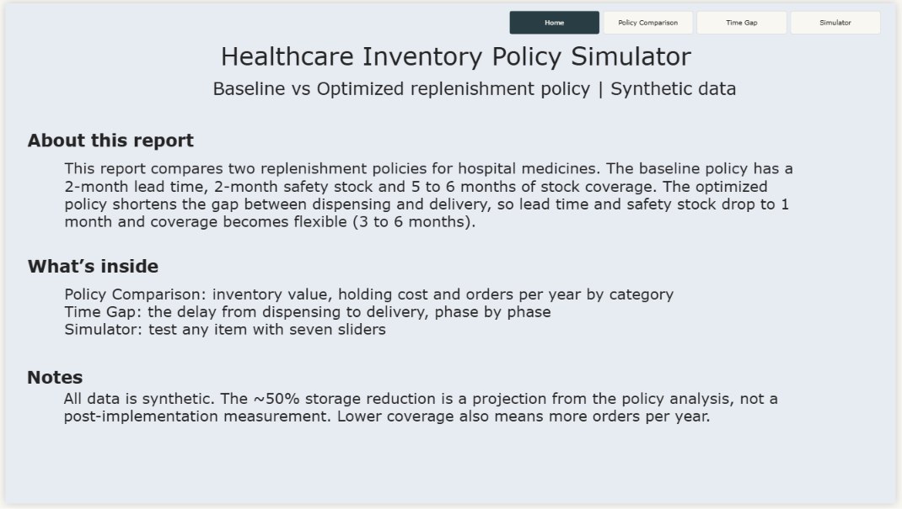
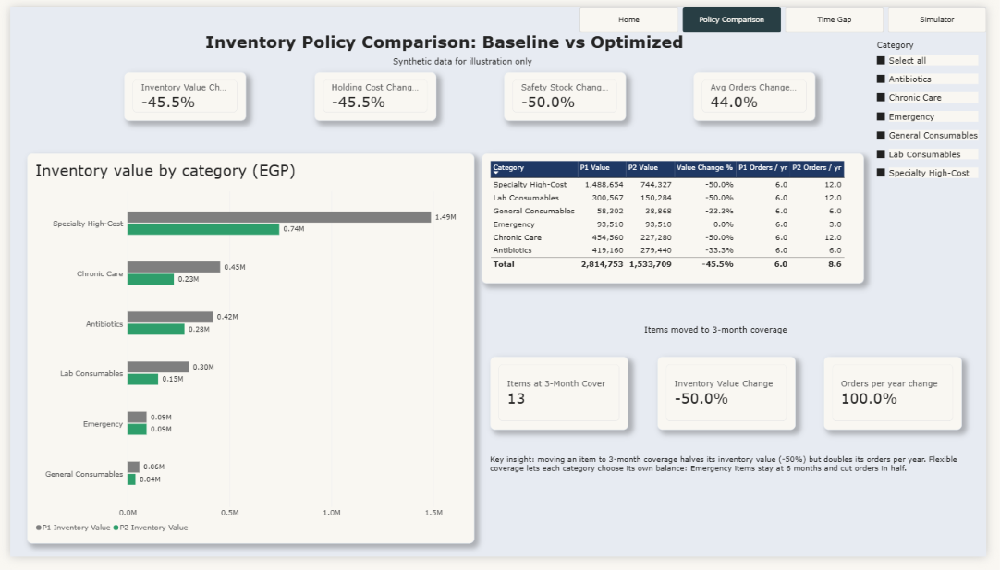
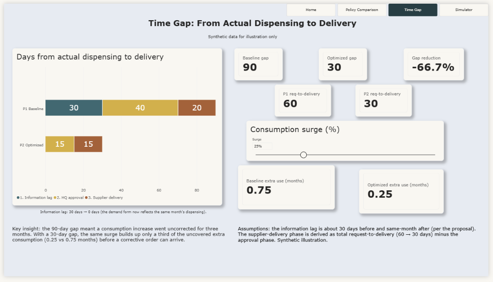
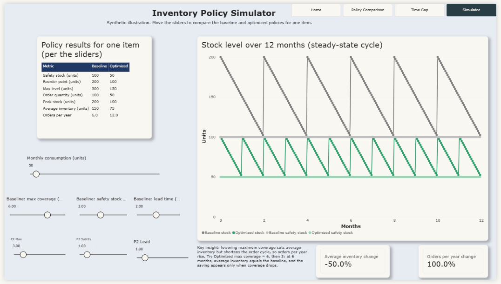

# Healthcare Inventory Policy Simulator

Policy analysis and redesign of a hospital medicine replenishment process, with an interactive Power BI simulator built on synthetic data.

> **All data in this repository is synthetic.** No real hospital or authority data, documents or names are included.

## Summary

In a public healthcare supply chain, medicine replenishment followed a rigid monthly request cycle. Two delays forced hospitals to hold 5 to 6 months of stock: demand forms reflected old dispensing data, and the approval cycle was long. I analyzed the request policy, redesigned its timeline and made stock coverage flexible (3 to 6 months). This repository recreates the policy logic on synthetic items in Excel and Power BI so the effect can be explored and tested.

**Role:** supply chain analyst (policy analysis, process redesign, modeling)
**Tools:** Power BI (DAX, Power Query, What-If parameters), Excel

## The problem

- Sub-stores (such as pharmacies) replenished at the start of the following month, so the monthly demand form reflected the dispensing of the month before.
- The approval cycle took about 40 days, and request-to-delivery took about 60 days.
- The total gap from actual dispensing to delivery was about **3 months**.
- To stay safe, the policy required a 2-month safety stock, a 4-month reorder point and 5 to 6 months of maximum coverage. Ordering less meant a stockout risk.

## What changed

| Metric | Before (Baseline) | After (Optimized) |
|---|---|---|
| Information lag (demand form vs actual dispensing) | ~30 days | same month |
| Approval cycle | 40 days | 15 days |
| Request to delivery | ~60 days | ~30 days |
| Total gap, dispensing to delivery | ~90 days | ~30 days |
| Lead time | 2 months | 1 month |
| Safety stock | 2 months | 1 month |
| Reorder point | 4 months | 2 months |
| Stock coverage per order | 5 to 6 months (could not go lower safely) | 3 to 6 months (flexible) |

The shorter gap is the root cause of the improvement. Once the delays shrank, the large protective buffer was no longer needed.

## Key findings (on the synthetic data)

- For items moved to **3-month coverage**, average inventory value and holding cost fall by **50%**.
- Across 25 synthetic items with a mixed coverage plan (3, 4 and 6 months), inventory value and holding cost fall by **45.5%** and safety stock by **50%**.
- **There is a trade-off.** Lower coverage means smaller orders, so orders per year rise. Items at 3 months go from 6 to 12 orders per year. Emergency items stay at 6 months and cut orders from 6 to 3 per year.
- At 6 months of coverage the average inventory equals the baseline (150 units in the worked example). The storage saving appears only when coverage drops.

Flexible coverage lets each category choose its own balance between storage and ordering effort.

## Outcome and limits of the claim

The redesigned policy was implemented. The storage figure is a **projection from the policy analysis** (coverage reduced from 5 to 6 months to 3 months, up to about 50% lower storage space and cost for items moved to 3 months). It is not a post-implementation measurement.

## Report pages

| Page | What it shows |
|---|---|
| Home | Overview, notes and navigation buttons |
| Policy Comparison | Baseline vs Optimized by category: inventory value, holding cost, safety stock and orders per year |
| Time Gap | The gap from dispensing to delivery, phase by phase (90 to 30 days), and how a consumption surge builds up before correction |
| Simulator | Seven sliders (consumption, lead time, safety stock and coverage for each policy) with a stock-level chart and a results table |

In the report, **P1 = Baseline policy** and **P2 = Optimized policy**.






## Model

For one item with average monthly consumption `d`:

- Safety stock = `d` x safety months
- Reorder point (ROP) = `d` x (safety months + lead time months)
- Max level = `d` x max coverage months
- Order quantity = Max level - stock at order time (the ROP)
- Peak stock = Max level - `d` x lead time months
- Average inventory = (Peak + Safety stock) / 2
- Orders per year = 12 x `d` / Order quantity

Worked example (50 units per month): the baseline gives safety stock 100, ROP 200, max 300 and order quantity 100. The optimized policy at 3 months gives safety stock 50, ROP 100, max 150 and order quantity 50.

## Repository structure

```
healthcare-inventory-policy-simulator/
├── README.md
├── data/        inventory_policy_simulator_data.xlsx   (synthetic items, parameters, results)
├── powerbi/     inventory_policy_simulator.pbix, dax_measures.md
├── images/      report screenshots
```

## How to use

1. Open `powerbi/inventory_policy_simulator.pbix` in Power BI Desktop.
2. If the data source path is different on your machine, go to Transform data, then Data source settings, and point the Excel source to `data/inventory_policy_simulator_data.xlsx`.
3. Change the blue input cells in the workbook (for example, the coverage plan in the `Items` sheet) and press Refresh to see the effect on every page.

## Assumptions and limitations

- Consumption is constant and the model shows a steady-state cycle for each item. It does not model demand variability.
- Items, consumption and unit costs are randomly generated. The holding cost rate (20% of inventory value per year) is an assumption.
- The timeline phases come from the policy proposal. The supplier-delivery phase is derived as total request-to-delivery minus the approval phase.
- The order quantity follows the original proposal's method (max level minus stock at order time).

## Author

Ahmed Aboelanen, supply chain analyst.
